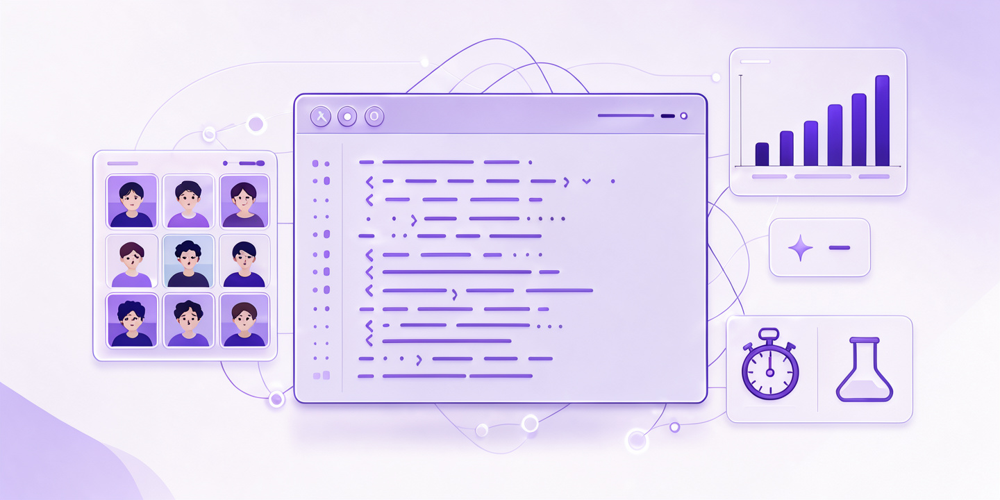

<div align="center">


# NexLab

**The virtual lab platform for educational institutions.**
Live proctored coding labs · an AI copilot for every role · graded DSA experiments ·
exams · a self-serve practice tier — all in one platform, tenant-isolated per institution.




-F97316)

</div>

---

## Why NexLab

Engineering lab courses live or die on three things: students actually coding, instructors
seeing what's happening in real time, and grades that survive an audit. NexLab was built
around those three:

- **Experiments are real code problems** (DSA labs: binary search, merging, sorting, …)
  submitted to a Docker-based execution engine with per-test-case verdicts — not fill-in
  forms.
- **Live labs are proctored and observed**: screen share is compulsory at join, screenshot
  frames land every 30 s, focus is scored from behavioral signals, and the instructor sees
  students **one at a time** — a conductor's view, not a spectator seat.
- **Grading is invariant-driven**: five rubric components must sum to 100, unassessed
  components are excluded (never zeroed), nothing-assessed is `NULL` (never 0), and hint
  usage costs 3/7/12 points (capped at 15). The same rules run for every student, every
  experiment, every semester.
- **An AI copilot sits inside every role's dashboard** — 65 role-scoped tools, Socratic
  hints for students (never solutions), autonomous multi-step workflows for institution
  admins, and strict "no success without an observation" honesty rules.

## What's inside

### 🏛 Institution admin — run the whole tenant
Academic year → departments → batches → sections → subjects, user lifecycle
(create/suspend/force-logout), announcements with targeting, AI usage & spend dashboards,
billing, security/audit views — and an AI copilot with **30 tools** (11 reads, 12 actions,
7 autonomous workflows like campus setup and executive reports).

### 👩‍ Instructor — build, run, grade
Create experiments with content pages, quizzes, checkpoints and a weighted rubric;
schedule lab sessions; run them live (broadcast, polls, one-to-one messages, extend,
force-submit); auto-grade submissions; hold vivas; publish exams. The copilot carries
**14 tools** — including `autonomous_live_session_conductor`,
`autonomous_bulk_autograde` and section analytics. Analytics tabs: overview, students,
experiments, engagement, mastery, rankings, integrity, trends, AI usage.

### 🧑‍ Student — practice, submit, improve
Join live labs (screen share on join), write and submit code in Python/C/C++/Java,
get Socratic hints (3 escalating levels, each with a grade cost), track grades,
exams, viva results, concept mastery, weak concepts and a full personal analytics
dashboard.

### 🚀 Free platform tier — self-serve learners
No institution needed: register, work through free courses (Python basics, DSA, C++),
attack **2,700+ practice problems** with a live runner, earn XP/levels/streaks,
claim daily & weekly quests, collect badges, follow study plans, and climb
per-course leaderboards.

### 🤖 The AI harness (one loop, five roles)
All roles share one Claw-Code-style harness: the same two endpoints, with role,
tenant, tool catalog and persona selected server-side from the JWT.

- **Provider chain per call**: Groq pools (qwen3.8-27b → gpt-oss-120b → gpt-oss-20b)
  → OpenRouter free pool (5 models) → Gemini last resort, with error-class cooldowns
  (429 → 60 s, 400/404 → 3600 s, 5xx → 300 s).
- **Governance gate**: per-institution daily/monthly token meters, per-student daily
  limit, platform daily cap — fail-closed, every call logged to `ai_usage_log`.
- **Honest AI**: the harness refuses to claim success without a tool observation,
  never invents names or IDs, and renders truncated detail as "unavailable".

### 🖥 Live labs & proctoring
`scheduled → active → ended` (or cancelled), with the proctoring loop while active:
compulsory screen share, 30 s screenshot frames, focus scores from signal JSON
(tab switches, fullscreen drops, idle, keystroke bursts), lockdown violations,
behavioral signals → risk score. On `ended`, background jobs finalize attendance,
recompute rankings and run the plagiarism check (~1 h later, difflib prefilter →
TF-IDF cosine, flag ≥ 0.85).

### 📊 Analytics & derived data
Everything the dashboards show is computed — nightly metric snapshots per student,
institution daily KPIs, rank snapshots, concept-mastery aggregation, cohort matrices,
trends, engagement, integrity clusters. No painted-on numbers: wipe the snapshots and
they recompute from the raw rows.

## Tech stack

| Layer | Technology |
|---|---|
| Frontend | Next.js 15 (App Router) · React 19 · CSS modules · Socket.IO client |
| Backend | Flask 3.0 · SQLAlchemy · Flask-Migrate (Alembic) · APScheduler (12 background jobs) · Socket.IO |
| Database | PostgreSQL 17 (103 tables, UUID PKs, `institution_id` tenant scoping) |
| AI | Groq (primary) → OpenRouter free (fallback) → Gemini (last resort); RAG embeddings for institutional documents |
| ML | Focus RF model (`.pkl` + rule fallback) · knowledge tracing · SPARK ranking · plagiarism · radon code quality |
| Code execution | Docker `docker run --rm` per submission (opt-in flag), admission control + reaper, canonical verdicts (AC / TLE / CE / RE / …) |
| Auth | JWT (role-claim gated), bcrypt, forced password change, optional 2FA flags |

## Quickstart (native, no Docker)

```bash
./setup.sh --seed      # Postgres 17 (:5433) + deps + schema + demo seeds + node
pip install groq==0.26.0
cd backend && python bootstrap_superadmin.py superadmin@nexlab.io 'SuperAdmin@2026' "Platform Super Admin"
# start the servers (or use up.sh, which keeps both alive):
#   backend :5000 (Flask + Socket.IO)   ·   frontend :3000 (Next.js)
python walkthrough.py       # 34/34 — SKIT institution via the real API
python make_activity.py     # 3 experiments · 3 sessions · 3 grades
python make_cohort.py       # +8 students + their grades (real instructor API)
python3 backend/database/seed_complete_demo.py   # full two-month dataset (idempotent)
```

Then open **http://localhost:3000** and log in:

| Role | Email | Password |
|---|---|---|
| Platform super admin | `superadmin@nexlab.io` | `SuperAdmin@2026` |
| Institution admin (SKIT) | `admin@skit.edu.in` | `SkitAdmin@2026` |
| Instructor | `anitha.rao@skit.edu.in` | `Instructor@2026` |
| Student (baseline) | `rahul.sharma@skit.edu.in` | `Student@2026` |
| Students `SKIT2026002…017` | `<name>@skit.edu.in` | `TempStud@2026` |
| Free platform users | `priya.raman@outlook.com` · `dev.patel@gmail.com` · `sanjana.nair@proton.me` | `Platform@2026` |

Every step above is idempotent — the whole chain is the documented disaster-recovery
procedure (drop the DB, repeat, done).

## The two-month demo dataset

`backend/database/seed_complete_demo.py` builds a **complete, realistic two months**
(2026-08-26 → 2026-10-26) for the SKIT tenant: 16 students with skill tiers that drive
attendance, attempt trajectories, exam accuracy and focus; 8 completed + 2 upcoming lab
sessions; ~175 code attempts with per-test-case results; vivas; a published mid-term exam
with attempts and retries; announcements, notifications, ~80 AI-usage rows, proctoring
events, interventions, a plagiarism cluster, concept mastery — and 3 free-tier platform
users with two months of practice history. It finishes by running the platform's **own**
nightly snapshot jobs, so every derived number is a genuine computation.

## Repository structure

```
├── backend/
│   ├── app/
│   │   ├── ai/               the Claw-Code harness, provider chain, gate, 65 role tools
│   │   ├── analytics/        domains, risk, freshness, snapshots, integrity
│   │   ├── exec_engine/      Docker runner, admission control, verdicts, reaper
│   │   ├── ml/               focus RF, knowledge tracing, plagiarism, ranking
│   │   ├── admin/ institution/ instructor/ student/ practice/
│   │   ├── platform_user/ platform_rank/ student_analytics/
│   │   ├── models/           103 SQLAlchemy models
│   │   ├── sockets/          21 Socket.IO events (live lab)
│   │   ├── jobs.py           12 APScheduler background jobs
│   │   └── __init__.py       app factory + boot-time DDL heal
│   ├── database/             schema.sql · init.sql · seeds (incl. seed_complete_demo.py)
│   ├── migrations/           Alembic history
│   ├── ml_training/          focus-model training pipeline
│   ├── tests/                regression suite (exec engine, sandbox, ranking, …)
│   └── run.py                server entrypoint (Socket.IO)
├── frontend/
│   ├── app/                  route areas: auth, admin, institution, instructor,
│   │                         student, platform user, practice, courses, …
│   ├── components/ services/ store/ hooks/ lib/
│   └── next.config.ts        /api/* + Socket.IO proxy to :5000
├── files/                    logo + hero art
├── docs/                     full documentation suite (33 files — see docs/README.md)
├── setup.sh                  one-shot native bootstrap (PG + deps + schema + seeds)
├── up.sh                     keep the whole stack alive in one process tree
├── walkthrough.py            34-step end-to-end tenant build through the real API
├── make_activity.py          baseline experiments/sessions/grades
└── make_cohort.py            baseline cohort (8 students + grades)
```

## Documentation

`docs/` holds the full suite — 33 files, strictly written from the code:

- `01-platform/` overview, architecture, roles & permissions
- `02-database/` schema overview, **generated 103-table reference**, relationships, migrations & seeding
- `03-backend/` **generated 538-route API reference**, execution engine, live labs, grading, practice, analytics, notifications
- `04-ai/` harness architecture, **the 5 tool catalogs**, provider chain & quota, memory/RAG, frontend integration
- `05-frontend/` structure & route map
- `06-role-guides/` practical walkthroughs per role (regression-verified)
- `07-ml/` the ML subsystem · `08-operations/` setup, env vars, troubleshooting
- `images/` 7 SVG diagrams used throughout

Start at [`docs/README.md`](docs/README.md) — it also lists the eight invariants that
must never break.

## Project notes

- **No Docker for the core stack** — by design, the platform runs natively (Docker is
  only ever needed for the opt-in code-execution engine).
- **Empty states are real** — the platform never fakes data; the demo dataset above is
  seeded deliberately and can be regenerated or removed.
- **Tenant boundary** — every tenant query filters `institution_id`; the lab AI returns
  403 for cross-tenant callers; RAG is tenant-scoped.
